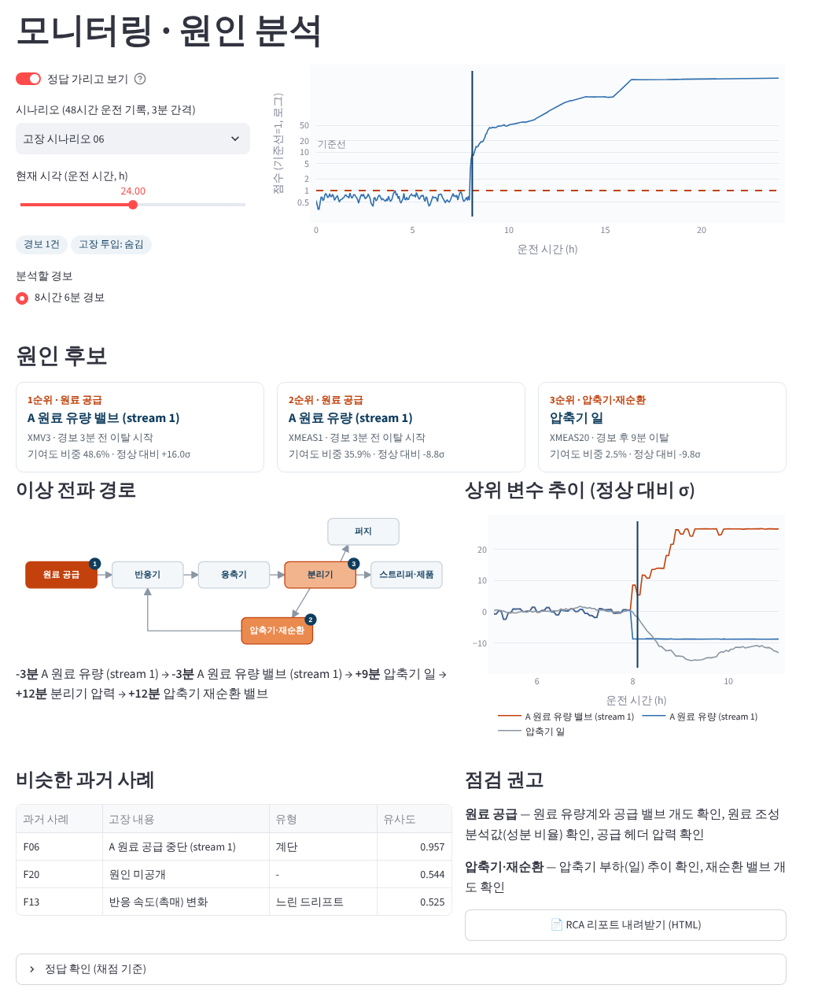
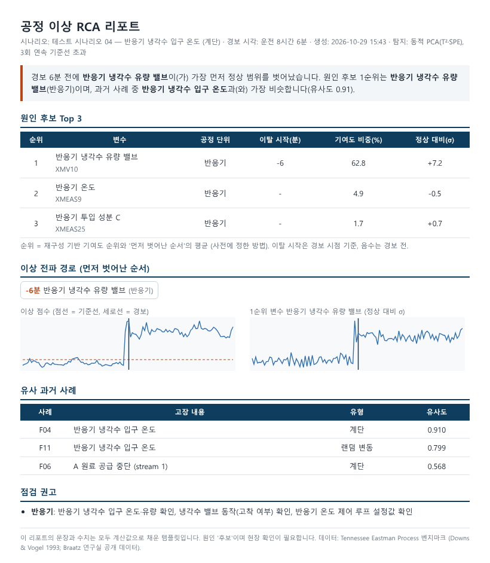
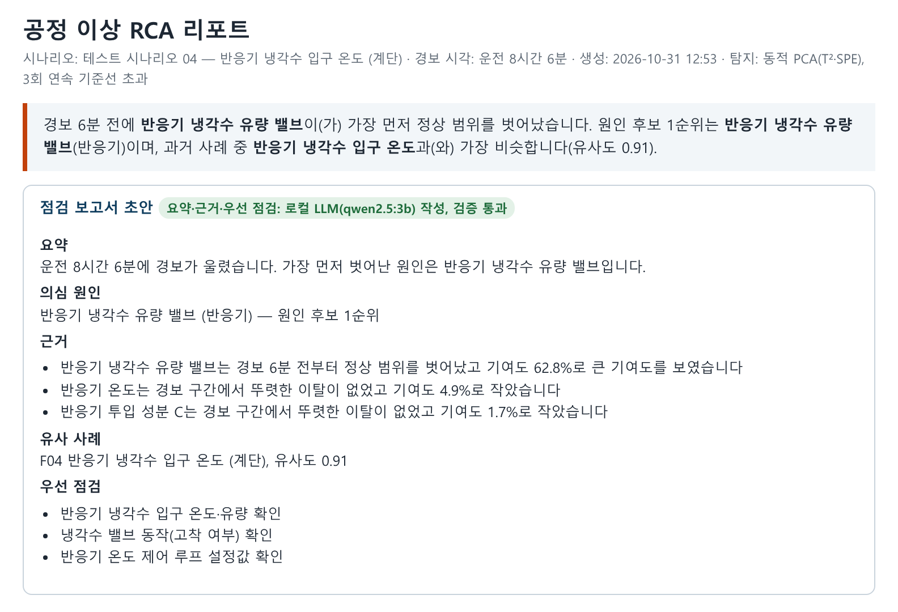

# 공정 이상 탐지 · 근본 원인 분석(RCA)

센서 데이터에서 **이상을 잡고 → 어떤 센서가 먼저 흔들렸는지 추적하고 → 원인 후보와 비슷한 과거 사례를 1장짜리 리포트로** 내는 파이프라인입니다.
원인 지목이 맞았는지 **결과를 보기 전에 정해 둔 정답으로 채점**했고, 실제 반도체 공정 데이터(SECOM)에서는 "불량 관련 센서"가 정말 원인 후보인지 시간 흐름까지 통제해 검증했습니다.



## 결과 요약

| 구분 | 결과 |
|---|---|
| 이상 탐지 (TEP 고장 21종) | 동적 PCA 평균 탐지율 **70.8%**, 오경보율 **0.6%**(3회 연속 초과 규칙), 탐지 지연 중앙값 **39분** |
| 탐지 방법 비교 | PCA 68.2% · 동적 PCA 70.8% · 오토인코더 66.6% · Isolation Forest 46.9% |
| RCA 정답 채점 (고장 11종) | '먼저 벗어난 순서'로 정답 원인 변수 1순위 **8/11** (실제 탐지된 9종 기준 8/9). SHAP은 **5/11** |
| 유사 과거 사례 검색 (고장 18종) | top-1 **78%**, top-3 **83%** (첫 버전 44% → 개선) |
| SECOM 검증 방식 | 무작위 분할 ROC-AUC **0.76** vs 시간순 분할 **0.56** |
| SECOM 원인 후보 | 단순 비교 25개 → 같은 주 안 비교 4개 → 뒤 기간에서 재현 **0개** |
| SECOM 변화 시점 | 2008-08-21 전후 불량률 **14.2% → 4.3%** (순열검정 p=0.003), 이때 바뀐 센서 11개 중 9개가 '불량 관련 센서'와 겹침 |

모든 수치는 `python scripts/run_all.py`로 다시 만들 수 있고, 깨끗한 복제본에서 재실행해 같은 값이 나오는 것을 확인했습니다.

## 무엇이 다른가

**1. RCA를 '채점'한다.** 보통은 SHAP 그래프를 보여주고 "이 센서가 원인"이라고 끝냅니다. 여기서는 고장 설명과 공정 구조만으로 고장별 정답 원인 변수를 먼저 정해
[`reports/rca_ground_truth.json`](reports/rca_ground_truth.json)에 저장하고 **git에 먼저 커밋(229ff09)한 뒤** 채점했습니다.

| 방법 | 정답 1순위 | 정답 3순위 안 | 공정 단위 1순위 |
|---|---|---|---|
| 단변량 z | 7/11 | 7/11 | 5/11 |
| PCA 잔차 기여도 | 7/11 | 8/11 | 6/11 |
| 재구성 기반 기여도(RBC) | 7/11 | 8/11 | 6/11 |
| SHAP (정상 vs 경보 구간 분류) | 5/11 | 6/11 | 3/11 |
| **먼저 벗어난 순서** | **8/11** | **8/11** | **7/11** |
| RBC + 순서 (사전 지정 결합) | 7/11 | 8/11 | 7/11 |

→ SHAP은 '정상과 잘 **구분되는** 변수'를 보여줄 뿐, 그 변수가 **원인**이라는 뜻은 아니라는 걸 숫자로 확인했습니다.
폐루프 공정에서는 제어기가 원인을 가리고 다른 변수로 증상이 옮겨 가기 때문에(예: 1번 고장은 유량 제어기가 조성 변화를 가려 압력이 먼저 반응), '언제 먼저 벗어났는가'가 '얼마나 크게 벗어났는가'보다 원인에 가까웠습니다.

**2. 전파 경로 + 유사 사례 + 자동 리포트.** 경보를 고르면 이상이 어느 공정 단위에서 시작해 어디로 번졌는지 흐름도에 순서대로 표시하고,
과거 고장 라이브러리에서 가장 비슷한 사례를 찾아 점검 항목과 함께 1장 리포트로 만듭니다. 리포트 문장은 계산값만으로 채운 템플릿이라 숫자를 지어낼 여지가 없습니다.



## 추가 기능: 로컬 LLM 점검 보고서 초안 (2026.10 추가)

경보마다 만들어지는 RCA 리포트는 표와 숫자 위주라, 현장 담당자가 바로 읽기에는 딱딱합니다. 그래서 **분석 결과를 로컬 LLM(Ollama, qwen2.5:3b)이 짧은 점검 보고서 문장으로 옮기는 기능**을 추가했습니다. 위의 탐지·RCA·SECOM 결과는 이 기능과 무관하며 바뀌지 않았습니다.


<sub>고장 4번 경보에 대해 노트북 CPU에서 실제로 생성된 초안 (`reports/rca_reports/llm/`)</sub>

**설계**
- 분석은 기존 코드가 하고, LLM은 결과를 문장으로 옮기기만 합니다. 답이 정해진 칸(의심 원인 = 1순위 후보, 유사 사례 = 1위 사례)은 코드가 채우고, LLM은 요약·근거를 쓰고 점검 목록에서 우선 점검을 고릅니다.
- LLM 문장은 코드로 검사합니다: 입력에 없는 숫자·변수·사례, %·σ·분 단위와 값의 짝, 변수별 시점·기여도, '가장 먼저' 순서, 최상급 표현, 변수 옆 공정 단위, 원인 대상, 인과 단정, 점검 목록 밖 항목, 변수 코드·입력 키 노출.
- 걸리면 위반 내용을 알려 주고 1번 다시 쓰게 하고, 그래도 틀리면 버리고 템플릿 문장을 씁니다. 거절된 초안 원문도 모두 저장합니다.
- 외부 API 없이 로컬에서만 동작합니다. Ollama가 없으면 템플릿 문장으로 대체됩니다.

**평가 (테스트 고장 21종의 첫 경보, i7-1355U 노트북 CPU)**

| 버전 | 바꾼 점 | 첫 시도 통과 | 재작성 후 통과 | 템플릿 대체 | 당시 통과 초안을 최종 규칙으로 재검사 |
|---|---|---|---|---|---|
| v1 | 분석 결과 JSON을 그대로 입력 | 16 | 18 | 3 | **0/18** |
| v2 | 코드 없는 문장형 입력 + 작성 예시, 검사 규칙 추가 | 7 | 12 | 9 | 6/12 |
| v3 | 정해진 칸은 코드가 채우고 LLM은 문장만, 순서·값 검사 추가 | 14 | **17** | 4 | 15/17 |

- **v1 → v2:** v1은 검사를 18건 통과했지만, 읽어 보니 대부분 `XMEAS30` 같은 변수 코드나 `이탈시작_경보기준_분` 같은 입력 키를 그대로 쓴 문장이었습니다. 검사가 '지어낸 숫자·변수'만 봤기 때문입니다.
- **v2 → v3:** 실패의 대부분이 '의심 원인' 칸이었습니다(1순위 대신 가장 먼저 벗어난 변수를 쓰거나, 예시의 공정 단위를 베낌). 통과 초안에도 '가장 먼저' 순서를 틀린 문장이 있었습니다.
- **v3 이후:** 통과 초안 17건 중 2건이 '기여도가 가장 큰/작은'을 틀리게 써서 최상급 검사를 추가했습니다(재검사 15/17). 이 규칙은 v3 실행 뒤에 추가해, 실제 사용 시 이 2건은 재작성 또는 템플릿 대체로 처리됩니다.
- 검증기 자체 점검: 정상 문장 21/21 통과, 일부러 틀린 내용을 넣은 문장 14종 280/280 차단 (`scripts/check_llm_guard.py`, LLM 없이 실행).
- 1건당 소요 시간 중앙값 34초(v3). 결과: `reports/llm_report_eval_v*.json`, 초안 원문: `reports/llm_report_samples_v*.json`, 재검사: `reports/llm_report_recheck.json`.

## 데이터

| 데이터 | 내용 | 용도 |
|---|---|---|
| [Tennessee Eastman Process](https://github.com/camaramm/tennessee-eastman-profBraatz) | 화학 공정 시뮬레이션, 변수 52개(측정 41 + 조작 11), 3분 간격, 고장 21종. 정상 학습 500개, 고장 학습 파일 480개, 테스트 파일 960개(8시간 시점 고장 투입) | 탐지·RCA 채점·유사 사례 |
| [SECOM (UCI)](https://archive.ics.uci.edu/dataset/179/secom) | 실제 반도체 공정, 1,567 lot × 센서 590개, 불량 104건, 2008.07~10 | 실제 데이터 전처리·원인 후보 검증 |

데이터 분할 원칙: 모델은 정상 데이터(`d00.dat`)로 학습, 경보 기준선은 학습에 안 쓴 정상 데이터(`d00_te.dat` 앞 480개)로 설정, 설정값 확인은 학습용 고장 파일로만, 최종 성적은 테스트 파일로 1회.
SECOM은 시간순 앞 70% 학습 / 뒤 30% 테스트.

## 파이프라인

1. **전처리·EDA** — 정상 구간 기준 표준화. 분석계 변수는 6분·15분마다 갱신(계단 모양), 제어 루프로 묶인 변수쌍은 상관 1.0 (예: 응축기 냉각수 밸브가 스트리퍼 유량을 제어 — `temain_mod.f`에서 확인)
2. **이상 탐지** — PCA(T²·SPE), 동적 PCA(시간 지연 2), Isolation Forest, 오토인코더를 같은 기준선·같은 평가로 비교
3. **원인 추적** — 경보 후 1시간 구간에서 변수별 기여도(RBC)와 '정상 범위를 먼저 벗어난 순서'(EWMA |z|>3, 3회 연속)를 계산해 원인 후보 순위
4. **유사 사례** — [평균 이동, 변동 크기]로 만든 시그니처를 코사인 유사도로 과거 고장과 비교
5. **리포트** — 원인 후보 Top 3, 전파 경로, 유사 사례, 공정 단위별 점검 항목
6. **SECOM** — 센서 정리(590 → 325), 시간순 검증, 같은 주 안 비교로 시간 흐름 통제, 부트스트랩 SHAP 안정성, 뒤 기간 재현 검정, 불량률 변화 시점 탐지

## 실행

```bash
pip install -r requirements.txt
python scripts/run_all.py      # 전체 분석 재실행 (약 2분) → reports/
streamlit run app.py           # 대시보드
```

Windows에서는 `1_분석_실행.bat`, `2_대시보드_실행.bat`를 더블클릭해도 됩니다.

로컬 LLM 보고서(선택): [Ollama](https://ollama.com) 설치 후 `ollama pull qwen2.5:3b`. 대시보드 모니터링 화면의 '초안 만들기' 버튼으로 쓰고, 평가는 `python scripts/run_llm_report_eval.py`(또는 `3_LLM_보고서_평가.bat`, 약 20~30분).

## 폴더 구조

```
app.py                     대시보드
src/
  tep_meta.py              변수 이름·공정 단위·고장 설명·RCA 정답
  tep_data.py              TEP 로더와 정상 데이터 분할
  detect.py                PCA/동적 PCA/Isolation Forest/오토인코더, 경보 규칙, RBC
  rca.py                   원인 순위 방법들, 채점, 전파 경로
  signature.py             고장 시그니처와 유사 사례 검색
  engine.py · report.py    대시보드·리포트용 분석 엔진과 HTML 리포트
  llm_report.py            로컬 LLM 점검 보고서 초안: 입력 작성, 검사 규칙, 재작성·템플릿 대체
  secom.py                 SECOM 로더·전처리
scripts/                   단계별 실행 스크립트
reports/                   실행 결과(수치·리포트 샘플)
docs/decision_log.md       의사결정 로그
```

## 의사결정 로그 (요약)

전체는 [docs/decision_log.md](docs/decision_log.md).

- 정답 원인 변수를 결과 보기 전에 커밋으로 고정 — 나중에 고치면 채점이 의미 없음
- 유사 사례 첫 버전(평균 이동만)은 44% → 실패한 고장이 대부분 랜덤 변동·밸브 고착형(평균은 그대로, 흔들림만 커짐) → '변동 크기' 추가, 학습 파일로 검증 후 반영 → 78%. 첫 버전 결과도 `reports/*_v1.*`에 보존
- SECOM은 무작위 분할 금지 — 주별 불량률이 23%→1%까지 변해 무작위로 섞으면 ROC-AUC가 0.56에서 0.76으로 부풀려짐
- SECOM 결론을 '불량 예측 모델'이 아니라 '변화 시점 감지 → 시점 전후 센서 비교 → 기간별 재검증'으로 바꿈 — 원인 후보가 뒤 기간에서 하나도 재현되지 않았기 때문

## 한계

- TEP는 시뮬레이션이라 실제 설비의 센서 고장·결측·운전 조건 변경이 없습니다. 그래서 SECOM을 함께 분석했습니다.
- RCA 정답은 공개된 고장 설명과 공정 구조로 정한 것이라 문헌마다 정답 세트가 조금씩 다를 수 있습니다. 단일 원인을 정할 수 없는 고장(3·8·9·10·13·16~20)은 채점에서 뺐습니다.
- 고장 15·21번은 경보가 고장 후 12시간 이상 지나서야 울려 사실상 미탐지입니다.
- SECOM 센서는 익명이라 원인 후보를 물리적으로 확인할 수 없습니다.
- LLM 보고서 검사는 숫자·이름·순서처럼 코드로 대조할 수 있는 것만 봅니다. 문장이 어색하거나(예: "변화가 작음의 변화") 미묘하게 뜻이 다른 표현은 걸러지지 않으며, 평가는 21건·3B 모델 한 가지로만 했습니다.

## 출처 · 라이선스 · AI 활용

- TEP: J.J. Downs & E.F. Vogel (1993), *A plant-wide industrial process control problem*; 데이터는 Braatz 연구실(University of Illinois) 공개 데이터 — 저작권 고지는 `data/raw/tep/LICENSE_Braatz.txt`
- SECOM: M. McCann & A. Johnston, UCI Machine Learning Repository (CC BY 4.0)
- RBC: C.F. Alcala & S.J. Qin (2009), *Reconstruction-based contribution for process monitoring*, Automatica 45(7)
- 코드와 분석은 생성형 AI(Claude)와 함께 작성했습니다.
