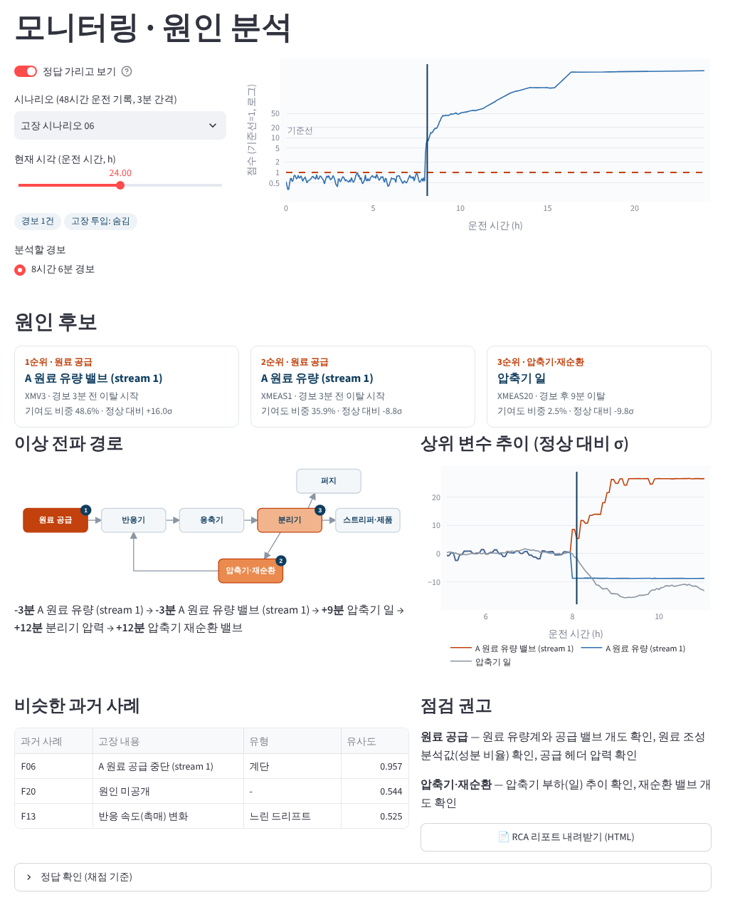
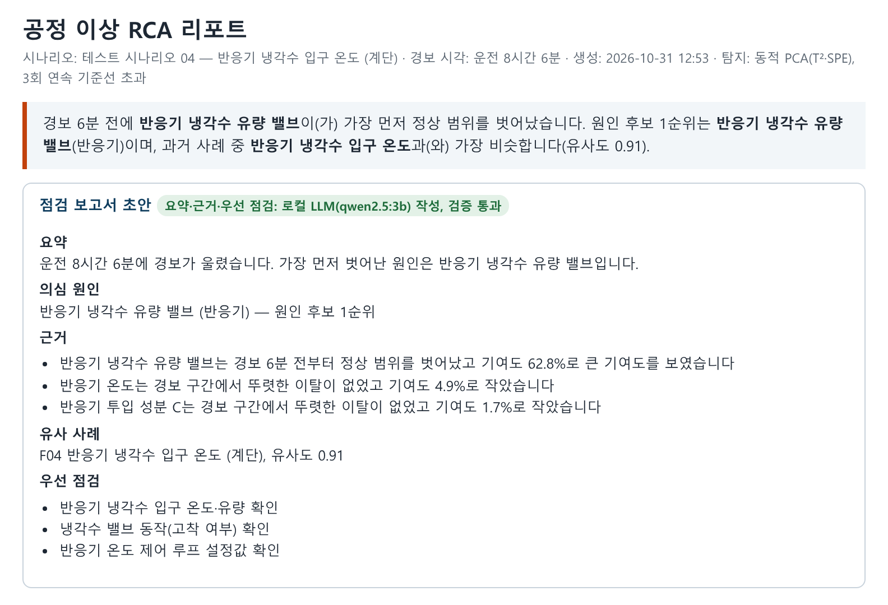

# 쉽게 읽는 프로젝트 설명

> 개발이나 통계를 몰라도 읽을 수 있게 쓴 설명입니다. 기술적인 내용은 [README](../README.md)에 있습니다.

## 1. 어떤 문제를 풀었나

공장 설비에는 온도, 압력, 유량 같은 값을 재는 센서가 수십 개씩 붙어 있습니다. 설비에 문제가 생기면 경보가 울리고, 그때부터 담당자는 이런 질문에 답해야 합니다.

1. **진짜 이상인가?** 센서가 잠깐 튄 건 아닌가
2. **원인이 어디인가?** 수십 개 센서 중 어디부터 확인해야 하나
3. **예전에도 이런 적이 있었나?** 있었다면 그때 원인은 무엇이었나
4. **보고서** 위 내용을 정리해서 공유

이 프로젝트는 이 네 단계를 **자동으로 처리하는 프로그램**입니다. 자동차 계기판에 경고등이 켜졌을 때 *"이 부품부터 확인해 보세요, 예전에 비슷한 증상은 이 고장이었어요"* 라고 알려 주는 정비 보조 도구라고 생각하면 됩니다.

## 2. 무엇으로 실험했나

| 데이터 | 쉽게 말하면 |
|---|---|
| **화학 공장 시뮬레이션 (TEP)** | 연구용으로 널리 쓰이는 가상 화학 공장. 센서 측정값 41개와 밸브 조절값 11개를 3분마다 기록했고, 고장 21종을 일부러 일으킨 기록이 있어서 **"맞혔는지"를 채점할 수 있습니다.** |
| **실제 반도체 공장 데이터 (SECOM)** | 실제 반도체 생산 기록. 생산 단위(lot) 1,567개, 센서 590개, 그중 불량 104개. 시뮬레이션만으로는 부족해서 실제 데이터로도 확인했습니다. |

## 3. 결과

### 이상 감지: 진짜 이상인가?

- 고장이 난 시간의 **약 71%를 '이상'으로 잡아냈습니다.**
- 정상인데 잘못 울린 경보는 **0.6%**입니다. 정상 운전 기록 1,000개 중 6개꼴입니다.
- 센서가 한 번 튈 때마다 경보가 울리지 않도록 **3번 연속으로 이상할 때만** 경보를 울리게 했습니다. 그 대신 경보가 6분쯤 늦어지는 것은 감수했습니다.
- 고장이 시작되고 경보가 울리기까지는 보통 **39분**이 걸렸습니다.
- 방법 4가지를 같은 조건으로 비교해서 가장 나은 방법을 골랐습니다.

### 원인 찾기: 어디부터 봐야 하나? (핵심)

- 정답 원인이 분명한 고장 11종 중 **8종에서 진짜 원인을 1순위로 지목했습니다.**
- **핵심 발견: "가장 크게 변한 센서"보다 "가장 먼저 변한 센서"가 원인일 가능성이 높았습니다.**
  - 도미노와 비슷합니다. 맨 끝 도미노가 가장 요란하게 쓰러져도, 원인은 처음 넘어진 도미노입니다.
  - 공장에는 자동 조절 장치가 있어서 문제가 생긴 곳을 바로 메우려고 합니다. 그래서 원인 지점의 변화는 작게 보이고, 영향을 받은 주변 설비가 오히려 크게 흔들립니다.
  - 요즘 많이 쓰는 AI 설명 방법(SHAP, 결과에 영향을 준 정도를 계산하는 방법)은 '크게 변한 것' 위주로 보여 줘서 11종 중 5종만 맞혔습니다.
- **정직한 채점:** 각 고장의 정답 원인을 결과를 보기 **전에** 기록해 두고(GitHub에 날짜와 함께 남김), 그 정답으로만 채점했습니다. 결과를 보고 정답을 슬쩍 바꾸는 일을 막기 위해서입니다.

### 비슷한 과거 사례 찾기

- 새 경보가 울렸을 때 패턴이 가장 비슷한 과거 고장을 찾아 줍니다.
- 고장 18종 중 **14종(78%)에서 같은 종류의 과거 고장을 1순위로 찾았습니다.**
- 첫 버전은 44%였습니다. 놓친 고장들을 살펴보니 "평균은 그대로인데 흔들림만 커지는" 유형이었고, '흔들림의 크기'를 함께 보도록 고쳐서 78%가 됐습니다.

### 실제 반도체 데이터: 그럴듯한 결과를 의심하기

- 처음에 단순히 비교하면 **"불량과 관련 있어 보이는 센서"가 25개** 나왔습니다.
- 그런데 같은 주(週) 안에서만 비교하니 4개로 줄었고, 다른 기간에서 다시 확인하니 **똑같이 나타나는 센서는 0개**였습니다.
- 이유를 찾아보니 **8월 21일 전후로 공정 상태가 크게 바뀌어** 불량률이 14.2%에서 4.3%로 떨어져 있었습니다. 이 시점에 값이 크게 바뀐 센서 11개 중 9개가 처음의 '불량 관련 센서'와 겹쳤습니다.
- 즉 겹친 센서들은 불량의 원인이라기보다 **"공정 상태가 바뀌었다"는 흔적**일 가능성이 높습니다. 불량률이 높던 시기와 낮던 시기에 센서 값이 달랐을 뿐이라는 뜻입니다.
- 시험 방식에 따라 성능이 크게 달라진다는 것도 확인했습니다.
  - 데이터를 무작위로 섞어서 시험하면 예측 점수가 0.76으로 좋아 보입니다.
  - 실제처럼 과거로 배우고 미래를 맞히는 방식으로 시험하면 0.56입니다. 동전 던지기가 0.5이니 거의 맞히지 못하는 수준입니다.
  - 그래서 결론을 "불량 예측 모델"이 아니라 **"공정 변화 시점을 찾아내고 기간별로 다시 확인하는 방법"**으로 바꿨습니다.

## 4. 추가 기능: AI가 쓰는 점검 보고서 초안 (2026.10)

분석 결과는 표와 숫자라서 현장 담당자가 바로 읽기 어렵습니다. 그래서 **AI가 분석 결과를 사람이 읽는 문장으로 정리**해 주는 기능을 넣었습니다.

- **AI는 내 노트북에서만 돌아갑니다.** 공장 데이터가 회사 밖으로 나가지 않도록 외부 AI 서비스(ChatGPT 등)를 쓰지 않았습니다.
- **AI는 판단하지 않고 옮겨 쓰기만 합니다.** 원인을 정하는 일은 위에서 채점한 분석 프로그램이 하고, AI는 그 결과를 문장으로 바꾸기만 합니다.
- **AI가 쓴 문장은 프로그램이 검사합니다.** AI는 가끔 그럴듯한 거짓말을 합니다. 그래서 문장에 나온 숫자, 센서 이름, "가장 먼저", "가장 큰" 같은 표현이 실제 분석 결과와 맞는지 하나하나 대조합니다. 틀리면 다시 쓰게 하고, 그래도 틀리면 미리 정해 둔 문장으로 대신합니다.

**세 번 고친 과정**

| 차수 | 무엇이 문제였나 | 어떻게 고쳤나 | 결과 (21건 중 AI 문장 채택) |
|---|---|---|---|
| 1차 | 검사는 18건 통과했지만, 읽어 보니 `XMEAS30` 같은 프로그램용 코드가 그대로 나와서 사람이 읽을 수 없었음 | AI에게 주는 자료를 사람이 읽는 문장으로 바꾸고, 검사 기준을 강화 | 18건 (지금 검사 기준으로 다시 보면 0건) |
| 2차 | 읽기는 좋아졌지만 '의심 원인' 칸을 자주 틀림 | 답이 정해진 칸은 프로그램이 직접 채우고, AI는 설명 문장만 쓰게 함 | 12건 |
| 3차 | 문장 대부분이 정확해짐. 2건은 "가장 큰/작은"을 거꾸로 씀 | "가장 큰/작은" 표현 검사를 추가 | **17건** (추가 검사 기준으로는 15건) |

교훈은 **"검사 통과율이 높다고 좋은 결과가 아니다"**라는 것입니다. 1차의 18건 통과는 검사 기준이 느슨해서 나온 숫자였습니다. 결과물을 직접 읽어 보고 검사 기준부터 고친 것이 가장 중요한 개선이었습니다.

## 5. 한계 (솔직하게)

- 원인 채점에 쓴 공장은 시뮬레이션이라, 실제 공장의 센서 고장이나 데이터 누락 같은 문제는 없습니다.
- 원인을 채점한 고장이 11종으로 많지 않습니다.
- 반도체 데이터는 센서 이름이 공개되지 않아, 후보로 걸러낸 센서가 실제로 어떤 장비인지는 확인할 수 없습니다.
- AI 보고서 검사는 숫자와 이름처럼 대조할 수 있는 것만 봅니다. 문장이 어색한 것까지는 걸러내지 못하고, 평가도 21건으로만 했습니다.
- 코드와 분석은 생성형 AI(Claude)와 함께 작성했습니다.

## 용어 풀이

| 용어 | 뜻 |
|---|---|
| 경보 / 오경보 | 이상하다고 알리는 신호 / 정상인데 잘못 울린 경보 |
| 원인 후보 | 프로그램이 "여기부터 보세요"라고 추천한 센서. 확정이 아니라 후보 |
| 기여도 | 경보에 각 센서가 얼마나 영향을 줬는지를 %로 나타낸 값 |
| σ (시그마) | 평소보다 얼마나 벗어났는지를 나타내는 단위. 클수록 평소와 다름 |
| 시뮬레이션 | 실제 공장 대신 컴퓨터로 만든 가상 공장 |
| 로컬 AI (LLM) | 인터넷의 AI 서비스가 아니라 내 컴퓨터 안에서 돌아가는 문장 생성 AI |
