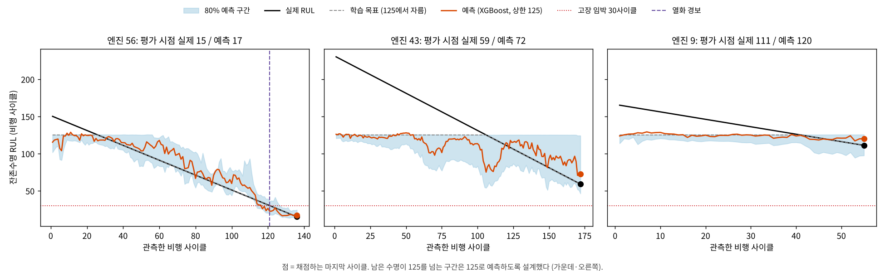

# 잔존수명(RUL) 예측: NASA C-MAPSS FD001

> - **무엇:** NASA 터보팬 엔진 시뮬레이션 데이터(FD001, 고압 압축기 HPC의 효율·유량 저하 1종, 해면 운항 조건 1개)로, 엔진이 성능 한계에 닿을 때까지 남은 비행 사이클 수를 예측했습니다.
> - **결과:** 평가용 엔진 100대에서 XGBoost의 RMSE는 **13.4 비행 사이클**입니다. 고장이 임박한 엔진(남은 수명 30 이하, 25대)에서는 **3.5**입니다.
> - **정비 관점:** 점 예측은 58%가 수명을 실제보다 길게 봤습니다. 80% 예측 구간의 하한을 쓰면 이 비율이 13%로 줄지만, 대신 정비가 중앙값 10.5사이클 앞당겨집니다.



TEP(화학 공장)와 C-MAPSS(항공기 엔진)는 서로 다른 시스템입니다. 두 분석을 잇는 것은 데이터가 아니라 방법입니다. TEP에서 쓴 이상 탐지 클래스(`src/detect.py`)와 '먼저 벗어난 순서' 규칙(`src/rca.py`)을 여기서 다시 썼습니다.

## 용어

- **상한 125:** 새 엔진은 센서에 열화가 거의 보이지 않아 남은 수명이 200이든 300이든 구별할 수 없습니다. 그래서 학습 목표를 `min(실제 남은 수명, 125)`로 자르는 방식을 씁니다(구간 선형 RUL, 문헌에서 흔히 쓰는 값). 이 모델은 125보다 큰 값을 예측하지 않습니다.
- **열화 경보:** 엔진마다 처음 30사이클을 정상으로 보고, 14개 센서의 최근 10사이클 평균으로 PCA T²·SPE 점수를 냅니다. 점수가 정상 기준선(학습 엔진 처음 30사이클의 99% 분위수)을 5사이클 연속 넘으면 경보를 울립니다.
- **수명 과대추정 (늦은 예측):** 예측한 남은 수명이 실제보다 긴 경우입니다. 정비가 늦어지므로 위험한 쪽입니다.

## 결과 (평가용 엔진 100대, 엔진별 마지막 사이클)

| 방법 | RMSE | NASA score | 수명 과대추정 비율 |
|---|---|---|---|
| 상수 (학습 평균) | 43.1 | 33,629 | 50% |
| Ridge, 상한 125 | 18.3 | 528 | 54% |
| **XGBoost, 상한 125** | **13.4** | **265** | 58% |
| *실패 실험* B: XGBoost, 상한을 교차검증으로 선택 (150) | 16.5 | 584 | 68% |
| *실패 실험* C: XGBoost, 엔진별 상한 = 열화 경보 시점 RUL | 44.7 | 15,567 | 17% |
| *실패 실험* D: 경보 전에는 고정값 54, 경보 후 XGBoost | 43.3 | 8,799 | 22% |

- RMSE의 정답은 상한 없는 공식 정답(`RUL_FD001.txt`)입니다. XGBoost 줄은 seed 5개 평균이고, seed에 따른 흔들림은 ±0.1 정도입니다. NASA score는 수명 과대추정에 더 큰 벌점을 주는 비대칭 지표의 합계로, 작을수록 좋습니다.
- B, C, D는 처음부터 비교하려고 계획한 아이디어였고, 기존 방식(상한 125)을 이기지 못했습니다. 아래 '무엇을 배웠나'에 이유를 적었습니다.
- **평가 엔진 100대에서 오는 불확실성 (사후 계산):** XGBoost RMSE의 부트스트랩 95% 구간은 10.8~16.0입니다. B와 XGBoost의 차이 구간은 1.3~5.0, Ridge와의 차이 구간은 2.8~7.2라서 이 두 순위는 확실합니다. 문헌의 LSTM(Zheng 외 2017, 16.1)과 DCNN(Li 외 2018, 12.6)은 모두 이 구간 안에 있으므로 '문헌과 비슷한 수준'까지만 말할 수 있습니다.

**실제 남은 수명 구간별 RMSE** (seed 0)

| 방법 | 30 이하 (25대) | 31~80 (20대) | 80 초과 (55대) |
|---|---|---|---|
| Ridge | 16.1 | 19.7 | 18.8 |
| **XGBoost** | **3.5** | 14.2 | 15.8 |
| B (150) | 3.9 | 16.7 | 19.7 |
| C | 4.8 | 22.1 | 58.6 |
| D | 11.4 | 12.2 | 57.4 |

**80% 예측 구간** (XGBoost 분위수 회귀 0.1·0.9, seed 0, 별도 보정 없음): 실제 남은 수명 125 이하 89대 중 82%가 구간 안에 들었습니다(전체 100대는 73%). 학습 목표를 125에서 잘랐기 때문에 구간 상한도 125를 넘지 못하고, 실제 수명이 125를 넘는 11대는 구조적으로 구간 밖입니다. 평균 폭은 35사이클입니다.


## 가설 확인 (기준 파일에 먼저 적은 것)

| | 가설 | 결과 |
|---|---|---|
| H1 | 상한 125에서 XGBoost < Ridge < 상수 | **맞음.** 13.4 < 18.3 < 43.1 |
| H2 | 행을 무작위로 섞은 검증이 엔진 단위 검증보다 점수가 좋게 나온다 | **맞음.** 같은 모델로 RMSE 9.2 대 11.5입니다(학습 데이터 전체 행, 정답 상한 125 기준이라 위 표와 직접 비교하는 숫자는 아님). 같은 엔진의 앞뒤 사이클이 학습과 평가에 섞이면 점수가 부풀어 오릅니다. SECOM에서 무작위 0.76, 시간순 0.56이 나온 것과 같은 구조입니다 |
| H3 | 열화 경보 기반 라벨(C, D)은 전체 RMSE에서 상한 125를 못 이긴다. D는 경보가 울린 엔진에서 더 낮을 수 있다 | **앞부분 맞음, 뒷부분 판정 불가.** 전체는 44.7, 43.3으로 졌습니다. 경보가 울린 30대에서는 D 6.3, XGBoost 7.0이었지만 17대만 D가 더 가까웠고 차이의 95% 구간이 −1.9~+1.5라 차이가 없다고 봅니다 |
| H4 | 80% 구간 실제 포함 비율이 남은 수명 125 이하 엔진에서 70~90% | **맞음.** 82% (전체 100대는 73%) |
| H5 | HPC 열화라면 T30·T50·P30·Ps30·phi가 먼저 벗어난다 | **틀림.** 학습 엔진 100대 중 44대만 이 다섯 개 중 하나가 가장 먼저 벗어났습니다(14개 중 5개를 무작위로 골랐을 때 기대치 약 36%). 1위는 Ps30(25대)으로 예상 안에 있었지만, 코어 회전수 Nc(22대)와 보정 코어 회전수 NRc(21대)가 그다음이었습니다 |

H5에 대한 가능한 설명(검증하지 않음): HPC 효율이 떨어지면 엔진 제어가 같은 추력을 내려고 연료를 늘리면서 코어 회전수가 함께 바뀔 수 있습니다. 예상 목록에 회전수를 넣지 않은 것이 엔진 물리를 덜 본 부분입니다. 또 '먼저 벗어남' 규칙은 잡음에 비해 변화가 큰 센서를 먼저 잡기 때문에, 그 순서가 물리적 원인의 순서를 뜻하지는 않습니다.

## 무엇을 배웠나

1. **상한을 교차검증으로 고르면 오히려 나빠졌다 (B).** 검증 엔진을 수명 전체에서 고르게 잘랐더니, 검증 시점 500개 중 12%가 실제 남은 수명 145를 넘었습니다(최대 314). 제곱 오차라서 이 소수의 긴 시점이 상한 선택을 좌우했고, 그래서 150이 골라진 것으로 봅니다. 평가용 엔진의 정답은 7~145였습니다. 사후에 남은 수명 145 이하 검증 시점만으로 다시 계산하면 115(14.2)와 125(14.3)가 가장 좋고 150은 16.1입니다. 이 사후 분석은 평가용 정답의 범위를 안 뒤에 한 것이라 증명이 아니라 설명입니다. 같은 이유로 교차검증 RMSE(XGBoost 27.3)는 평가용 결과(13.4)보다 훨씬 큽니다.
2. **열화 경보를 먼저 잡고 그 뒤부터 수명을 세는 아이디어(C, D)는 졌다.** 학습 엔진에서 경보는 고장 전 중앙값 54사이클에야 울렸습니다. 평가용 데이터는 고장 전에 잘려 있어서, 남은 수명이 긴 엔진 70대는 마지막 사이클까지 경보가 없는 게 자연스럽습니다. 두 방법은 서로 다른 이유로 틀렸습니다.
   - **D**는 경보가 없는 엔진에 고정값 54를 냈습니다. 54는 학습 엔진에서 '경보 시점의 남은 수명' 중앙값입니다. 남은 수명이 긴 엔진은 크게 짧게 예측했고, 남은 수명이 54보다 짧은데 경보가 없던 6대는 늦게 예측했습니다. 그중 고장이 임박한(30 이하) 3대는 26~36사이클 늦었습니다. 남은 수명 30 이하 구간 RMSE가 D 11.4, XGBoost 3.5입니다. 정비 관점에서 가장 위험한 실패입니다.
   - **C**는 엔진별 학습 목표 상한 자체가 낮아(경보 시점 남은 수명 중앙값 54, 최대 108) 예측이 전반적으로 짧아졌습니다. 그래서 수명 과대추정은 17%로 적지만 전체 오차가 큽니다.
3. **구간 하한을 쓰면 수명 과대추정이 줄고, 대가는 더 이른 정비다.** 남은 수명 125 이하 89대에서 하한까지 실제보다 늦은 엔진은 12대(13%)로 명목 10%보다 조금 많았습니다(늦은 폭 중앙값 2.8, 최대 11.7사이클). 하한을 쓰면 실제보다 중앙값 10.5사이클 일찍 정비하게 됩니다. 어느 쪽을 쓸지는 정비 비용과 고장 비용을 보고 정할 일입니다.

## 의사결정

| 결정 | 버린 대안 | 근거 |
|---|---|---|
| 평가 기준을 평가용 데이터 실행 전에 커밋 (`3368379`) | 결과를 보며 설정 조정 | TEP RCA 정답 사전 등록(`229ff09`)과 같은 이유 |
| 평가용 엔진은 마지막 사이클만, 1회 평가 | 모든 사이클 평가 | 공식 정답이 마지막 사이클 기준으로 엔진당 1개. 실행 후 `results/test_done.json`이 다시 실행되는 것을 막음 |
| 학습 데이터 안 검증은 엔진 단위 GroupKFold 5겹 | 행 무작위 KFold | H2: 9.2 대 11.5 |
| 특징은 과거 값만 (최근값, 10사이클 평균, 30사이클 기울기, 운전 사이클 수) | 중앙 이동평균, 총수명 비율 | 미래 값을 쓰면 누수. 테스트(`test_features_use_only_past`)로 확인 |
| 센서 14개 (학습 데이터에서 고유값 2개 이하인 센서 7개 제외) | 21개 전부 | 규칙을 학습 데이터만 보고 정함 |
| 하이퍼파라미터 탐색 없음 | 그리드 탐색 | 고를 것을 상한 하나로 제한해 과적합 여지를 줄임 |
| 딥러닝(LSTM·CNN)은 넣지 않음 | LSTM 비교 | 범위를 줄이고 검증에 집중. 다음 단계로 둠 |

## 한계

- C-MAPSS는 시뮬레이션 데이터이고, 공개 벤치마크로 오프라인 평가한 결과입니다. 실제 엔진 데이터로 검증하지 않았습니다.
- 물리 모델과 연계하지 않았습니다. H5처럼 문서(Saxena 외 2008)를 근거로 반응할 센서를 먼저 예상하고 확인한 정도입니다. C-MAPSS의 센서 추세는 문헌에 알려져 있어 완전한 블라인드 예측은 아니었습니다.
- 운항 조건이 하나뿐인 FD001만 썼습니다. 조건이 여러 개인 FD002·FD004는 하지 않았습니다.
- C-MAPSS에는 열화 시작 시점의 정답이 없어서 경보의 '정확도'는 잴 수 없습니다. 처음 30사이클 안의 오경보는 0건이었습니다.
- **기준 파일 커밋 전의 사전 실험:** 계획을 점검하는 단계에서 AI 도구로 평가용 데이터에 빠른 실험을 한 번 돌렸고, 상한 125·130·없음의 결과와 경보 간이 점검 결과를 본 상태에서 기준을 정했습니다. 기준 파일(`protocol.json`)의 disclosure에 적은 '검토자'가 이 작업입니다. 그래서 상한 125는 완전히 블라인드로 고른 값이 아니고, H3의 예상도 그 결과에 영향을 받았습니다.
- 기준 파일과 다르게 한 점: 구간별 RMSE, D의 경보 있음/없음 분리, 80% 구간은 seed 0 하나로만 계산했습니다. H5에서 먼저 벗어난 센서가 여러 개로 같으면, 그중 하나라도 예상 목록에 있으면 맞은 것으로 셌습니다(3건, 판정은 바뀌지 않음).
- 결과 확인: 저장소 코드를 쓰지 않고 기준 파일만 보고 새로 짠 코드로 XGBoost RMSE 13.39를 다시 얻었고, 깨끗한 복제본에서 다시 실행한 결과도 같았습니다. 이 확인도 AI 코딩 도구로 했습니다.
- 이 모듈은 2026년 11월 23일에 만들었습니다(커밋 기록 참고). 커밋 메시지 `5025087`의 "가설 5개 확인"은 '5개를 확인했다'는 뜻이고, 결과는 위 표대로 4개 맞음, 1개 틀림(H3 뒷부분은 판정 불가)입니다.

## 실행

```bash
pip install -r rul/requirements-rul.txt
python rul/run_rul.py cv              # 학습 데이터만으로 교차검증 → results/cv.json
python rul/run_rul.py test            # 평가용 데이터 1회 → results/test.json, test_predictions.csv
python rul/posthoc.py                 # 사후 분석 숫자 → results/posthoc.json
python rul/make_figures.py            # figures/
python -m pytest rul/tests -q         # 불변 조건 테스트 14개
```

`results/test_done.json`은 평가용 데이터를 한 번 돌렸다는 잠금 파일입니다. 저장소를 받아 결과 재현만 확인하려면 `python rul/run_rul.py test --force`로 돌리면 되고, 같은 숫자가 나옵니다.

## 출처

- 데이터: NASA Prognostics Center of Excellence, CMAPSS Jet Engine Simulated Data ([출처와 해시](../data/raw/cmapss/SOURCE.md))
- A. Saxena, K. Goebel, D. Simon, N. Eklund, "Damage Propagation Modeling for Aircraft Engine Run-to-Failure Simulation," PHM08, 2008
- 코드는 대부분 AI 코딩 도구(Claude Code)로 작성했습니다. 평가 기준과 가설은 먼저 커밋하고, 결과는 사람이 확인했습니다.
