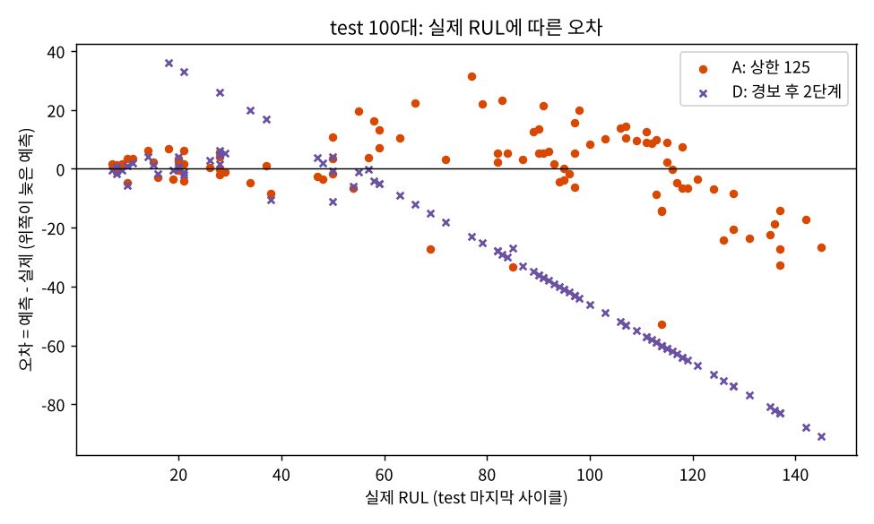

# 잔존수명(RUL) 예측: NASA C-MAPSS FD001

이 저장소의 TEP·SECOM 분석에 이어, **고장까지 남은 사이클 수(잔존수명, RUL)를 예측**하는 실험입니다. 데이터는 NASA가 공개한 터보팬 엔진 열화 시뮬레이션 C-MAPSS의 FD001(운전 조건 1개, HPC 열화 1종)입니다. TEP는 화학 공장, C-MAPSS는 항공기 엔진이라 **서로 다른 시스템**입니다. 이어지는 것은 방법입니다. TEP에서 쓴 이상 탐지 클래스(`src/detect.py`의 PCA T²·SPE)와 '먼저 벗어난 순서' 규칙(`src/rca.py`)을 여기서 다시 썼습니다.

> **평가 기준은 공식 test를 돌리기 전에 커밋했습니다** ([`rul/protocol.json`](protocol.json), 커밋 `3368379`). 상한 125, 특징, 모델 설정, 지표, 가설 5개를 그때 고정했고, 공식 test는 그 뒤 한 번만 평가했습니다. 기준을 정하기 전에 계획 검토 중 test로 빠른 실험을 한 번 해 본 적이 있어, 그 사실과 숫자도 protocol에 적어 두었습니다.

## 결과 (공식 test 100대, 엔진별 마지막 사이클)

| 방법 | RMSE | RMSE (정답에 상한 125) | NASA score | 늦게 예측한 비율 |
|---|---|---|---|---|
| A 상수 (학습 평균) | 43.1 | 41.9 | 33,629 | 50% |
| A Ridge | 18.3 | 17.1 | 528 | 54% |
| **A XGBoost, 상한 125** | **13.4 ± 0.1** | **12.1** | **265** | 58% |
| B XGBoost, 상한을 교차검증으로 선택 (150) | 16.5 ± 0.1 | 16.3 | 584 | 68% |
| C XGBoost, 엔진별 상한 = 열화 경보 시점 RUL | 44.7 ± 0.1 | 42.8 | 15,567 | 17% |
| D 2단계 (경보 전 고정값, 경보 후 XGBoost) | 43.3 ± 0.0 | 41.4 | 8,799 | 22% |

- RMSE의 정답은 상한 없는 공식 정답(`RUL_FD001.txt`)입니다. XGBoost는 seed 5개의 평균 ± 표준편차입니다.
- NASA score는 늦은 예측(실제보다 길게 본 예측)에 더 큰 벌점을 주는 비대칭 지표의 합계입니다. 작을수록 좋습니다.
- **80% 예측 구간** (XGBoost 분위수 회귀): 실제 RUL이 125 이하인 엔진 89대 중 82%가 구간 안에 들었습니다(전체 100대는 73%). 평균 폭은 35사이클입니다. 점 예측은 58%가 늦었지만, 구간의 하한은 12%만 실제보다 늦었습니다.
- 참고로 같은 FD001에서 문헌의 LSTM은 RMSE 16.1, DCNN은 12.6 수준입니다. 평가 방식(정답 상한 처리 등)이 논문마다 달라 바로 비교하지는 않습니다.




## 가설 확인 (protocol에 먼저 적은 것)

| | 가설 | 결과 |
|---|---|---|
| H1 | 상한 125에서 XGBoost < Ridge < 상수 | **맞음.** 13.4 < 18.3 < 43.1 |
| H2 | 행을 무작위로 섞은 검증이 엔진 단위 검증보다 점수가 좋게 나온다 | **맞음.** 같은 모델로 RMSE 9.2 대 11.5. 같은 엔진의 앞뒤 사이클이 학습과 평가에 섞이면 점수가 부풀어 오릅니다. SECOM에서 무작위 0.76, 시간순 0.56이 나온 것과 같은 구조입니다 |
| H3 | 열화 경보 기반 라벨(C, D)은 전체 RMSE에서 A를 못 이긴다 | **맞음.** 44.7, 43.3. 다만 경보가 울린 엔진 30대만 보면 D가 6.3, A가 7.0이었습니다(seed 0, 30대라 차이를 단정하지 않음) |
| H4 | 80% 구간 실제 포함 비율이 RUL≤125 엔진에서 70~90% | **맞음.** 82% |
| H5 | HPC 열화라면 T30·T50·P30·Ps30·phi가 먼저 벗어난다 | **틀림.** 엔진 100대 중 44대만 이 다섯 개 중 하나가 가장 먼저 벗어났습니다. 1위는 Ps30(25대)으로 예상 안에 있었지만, 코어 회전수 Nc(22대)와 보정 코어 회전수 NRc(21대)가 그다음이었습니다. 예상 목록에 회전수를 넣지 않은 것이 빗나간 이유입니다 |

## 무엇을 배웠나

1. **상한을 교차검증으로 고르면 오히려 나빠졌다 (B).** 검증 엔진을 자를 때 수명 전체에서 고르게 시점을 뽑았기 때문에, 검증 정답에 RUL 200~300의 긴 시점이 많이 들어갔습니다. 그래서 교차검증은 큰 상한(150)을 골랐습니다. 하지만 공식 test의 정답은 7~145라 상한 125가 더 맞았습니다. **검증 데이터를 실제로 예측할 상황과 비슷하게 만들지 않으면, 검증으로 고른 설정이 틀릴 수 있다**는 것을 숫자로 확인했습니다. 기준을 먼저 고정해 두었기 때문에 test를 본 뒤 상한을 바꾸지 않았습니다.
2. **열화 경보로 '언제부터 닳기 시작했는지'를 잡는 아이디어(C, D)는 전체 성능에서 졌다.** 경보는 고장 전 중앙값 54사이클에서야 울렸습니다. test 엔진 70대는 마지막 사이클까지 경보가 없었고, 이 엔진들에는 고정값 54를 낼 수밖에 없어 크게 틀렸습니다. 경보가 울린 뒤 구간에서는 A와 비슷하거나 조금 나았습니다. 경보는 '언제 정비를 준비할지' 알리는 신호로는 쓸 수 있지만, 그 자체로 RUL 라벨을 대신하기에는 늦었습니다.
3. **점 예측보다 구간이 정비에 맞다.** 점 예측은 절반 넘게 늦었습니다. 정비 계획에는 80% 구간의 하한을 쓰는 편이 안전합니다(늦은 비율 12%).

## 의사결정

| 결정 | 버린 대안 | 근거 |
|---|---|---|
| 평가 기준을 test 전에 커밋 (`3368379`) | test를 보며 설정 조정 | TEP RCA 정답 사전 등록(`229ff09`)과 같은 이유 |
| 공식 test는 엔진별 마지막 사이클만, 1회 평가 | 모든 사이클 평가 | 공식 정답이 마지막 사이클 기준 엔진당 1개. 실행 후 `results/test_done.json`이 재실행을 막음 |
| 학습 데이터 안 검증은 엔진 단위 GroupKFold 5겹 | 행 무작위 KFold | H2: 9.2 대 11.5 |
| 특징은 과거 값만 (최근값, 10사이클 평균, 30사이클 기울기, 운전 사이클 수) | 중앙 이동평균, 총수명 비율 | 미래 값을 쓰면 누수. 테스트(`test_features_use_only_past`)로 확인 |
| 센서 14개 (학습 데이터에서 고유값 2개 이하 센서 7개 제외) | 21개 전부 | 규칙을 학습 데이터만 보고 정함 |
| 하이퍼파라미터 탐색 없음 | 그리드 탐색 | 고를 것을 상한 하나로 제한해 과적합 여지를 줄임 |
| 딥러닝(LSTM·CNN)은 넣지 않음 | LSTM 비교 | 범위를 줄이고 검증에 집중. 다음 단계로 둠 |

## 한계

- C-MAPSS는 시뮬레이션 데이터이고, 공개 벤치마크로 오프라인 평가한 결과입니다. 실제 엔진 데이터로 검증한 것이 아닙니다.
- 물리 모델과 연계하지 않았습니다. H5처럼 문서(Saxena 외 2008)를 근거로 반응할 센서를 먼저 예상하고 확인한 정도입니다. C-MAPSS의 센서 추세는 문헌에 알려져 있어 완전한 블라인드 예측은 아니었습니다.
- 운전 조건이 하나뿐인 FD001만 썼습니다. 조건이 여러 개인 FD002·FD004는 하지 않았습니다.
- test 엔진이 100대뿐이라 작은 차이는 의미가 없습니다.
- C-MAPSS에는 열화 시작 시점의 정답이 없어서 경보의 '정확도'는 잴 수 없습니다. 처음 30사이클 안의 오경보는 0건이었습니다.

## 실행

```bash
pip install -r rul/requirements-rul.txt
python rul/run_rul.py cv        # 학습 데이터만으로 교차검증 → results/cv.json
python rul/run_rul.py test      # 공식 test 1회 → results/test.json, test_predictions.csv
python rul/make_figures.py      # figures/
python -m pytest rul/tests -q   # 불변 조건 테스트 10개
```

## 출처

- 데이터: NASA Prognostics Center of Excellence, CMAPSS Jet Engine Simulated Data ([출처와 해시](../data/raw/cmapss/SOURCE.md))
- A. Saxena, K. Goebel, D. Simon, N. Eklund, "Damage Propagation Modeling for Aircraft Engine Run-to-Failure Simulation," PHM08, 2008
- 코드는 대부분 AI 코딩 도구(Claude Code)로 작성했습니다. 평가 기준과 가설은 먼저 커밋하고, 결과는 사람이 확인했습니다.
